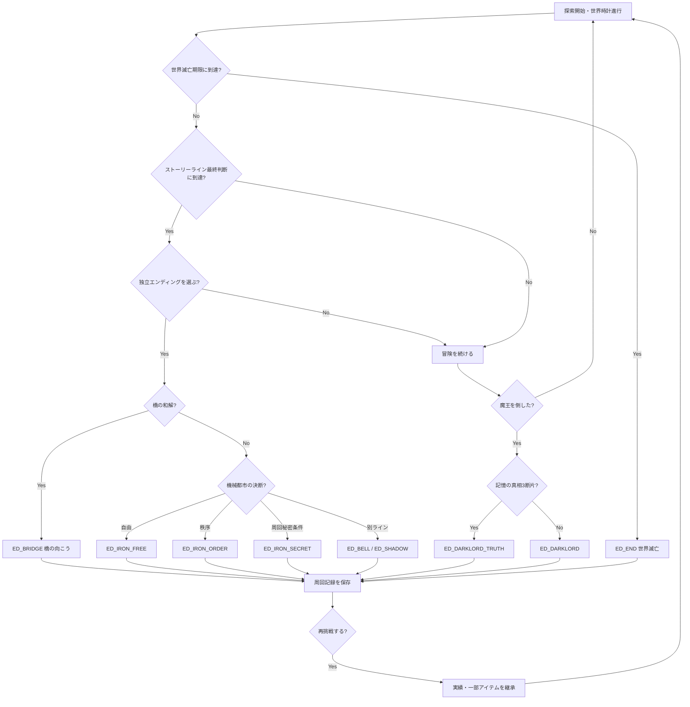

# フェーズ1 — ストーリーラインとエンディング設計（提案 v0.1）

## 大型ストーリーライン設計テンプレート
```yaml
id: story_unique_id
title: 物語名
theme: 中心テーマ
cast_recruited: [ch_a, ch_b]  # 控えを含む
required_active: [ch_a]      # 原則1人以下
phase_window: [2, 3]
start_trigger: event_id
stages:
  - id: discover
    enter_condition: {...}
    triggers: [...]
    rewards: [...]
  - id: crisis
    enter_condition: {...}
    choice: [a, b]
    consequences: [...]
  - id: resolution
    enter_condition: {...}
    endings: [ending_id]
missable_handling: 代替の手掛かり／別時期の分岐
world_effects: [地図, NPC, 敵, 交易の変化]
fail_forward: 失敗しても噂や別ルートが開く
```

### サンプルA：「橋の向こう」
- **テーマ**：橋の向こうに残された人々の「帰る場所」を決める。リッキー（前兆期に加入）、メリル（前兆期限定）、ゴロー（崩壊期から加入）の3人が関わる。
- **起動条件**：リッキーとメリルが加入済み／世界時期2以降／崩落した橋を発見。起動にゴローの加入は不要。
- **同行条件**：橋の調査イベント時だけメリルをアクティブ編成に入れる。
- **第1幕 手掛かり**：失踪した隊商の名簿と壊れた橋脚。昼の行商人／夜の木こりで矛盾する証言。
- **第2幕 岐路**：ゴローを加入させれば戦闘を回避して住民を避難させる交渉ルート。未加入なら危険な地下水路で救助。
- **第3幕 真実**：メリルが橋を封鎖したのは敵を止めるためだけではなく、片側の村の秘密を守るためだった。
- **選択A：橋を再建**。避難の安全を確保するが、隠された旧文明の入口が塞がる。仲間関係に亀裂。
- **選択B：橋を壊したまま残す**。旧文明入口と別ルートが開く一方、避難民の生活が難しくなる。
- **最終判断**：双方の村の代表を説得する証拠（異なる時期の手掛かり）が揃えば「第三の渡し」を建設し、**『橋の向こう』独立エンディング**へ。魔王討伐なしで終了可能。
- **未達成への救済**：前兆期のメリルを逃した場合は加入しないが、崩壊期の遺品から真相の一部と別の結末を見られる。真エンドのみ不可。
- **必要な状態例**：`bridge_found`, `bridge_truth`, `goro_recruited`, `bridge_choice`, `ferry_built`。
- **周回限定枝**：前周で「橋の向こう」到達記録があり、今周で橋を壊したままにした場合だけ、旧文明の入口に「誰かが置いた小舟」が出現。追加エンディングの証拠となる。

### サンプルB：「鉄の心臓」
- **テーマ**：機械に「魂」があるかではなく、自己決定できるかを問う。ホランド／.Z／ドクター・ゴクスワーズ（最大3人）。
- **起動条件**：ホランドと.Zが加入済み、時期2以降、古い工場の動力炉を発見。
- **同行条件**：工場深部では.Zのみアクティブ必須。
- **第1幕**：工場に記録された「最後の命令」は世界救済ではなく、機械都市の住民抹消だった。
- **第2幕**：ドクターがいれば命令の改ざん元が判明。いなくても機械室の3点照合で代用可能（難度高）。
- **分岐A：命令を消去**。機械都市は自由になるが防衛が弱まり敵が侵攻。
- **分岐B：命令を継承**。一時的に住民は守られるが.Zは自らの意思を失う。
- **隠し分岐C：分散記憶**。前周回の特定実績＋ホランドの個別編を解決＋時期3に動力炉へ戻ると発生。自由意思と防衛を両立する代わりに主人公が「失った記憶」の一部を手放す。
- **結末**：A=機械都市自由エンド／B=機械都市秩序エンド／C=『鉄の心臓』秘密エンド。いずれも魔王討伐なしで独立終幕。
- **未加入のドクター**：必須にしない。「知っている人」と「そこにいた人」の違いを作る。

## エンディング一覧（初期スコープ）
| ID | 名称 | 系統 | 条件案 | 周回必須 |
|---|---|---|---|---|
| ED_DARKLORD | 魔王討伐 | メイン | 魔王戦に勝利 | なし |
| ED_DARKLORD_TRUTH | 命令の裏側 | メイン分岐 | 討伐＋主人公の記憶の真相3断片 | なし |
| ED_BRIDGE | 橋の向こう | ライン | 渡し建造＋両村の和解 | なし |
| ED_BRIDGE_SCAR | 片岸の春 | ライン分岐 | 橋の事件解決＋救助に偏り | なし |
| ED_IRON_FREE | 鉄の心臓・自由 | ライン | 命令消去 | なし |
| ED_IRON_ORDER | 鉄の心臓・秩序 | ライン | 命令継承 | なし |
| ED_IRON_SECRET | 鉄の心臓・第三命令 | ライン隠し | 分散記憶＋特定実績 | **あり** |
| ED_BELL | 白い鐘 | 将来ライン | ルル／マヤ関連の封印解除 | なし |
| ED_SHADOW | 影の契約 | 将来ライン | ギーネ／ルイス関連の契約破棄 | なし |
| ED_SOLO | ただ一人の王 | ソロ分岐 | 主人公のみ＋専用ジョブの試練 | なし |
| ED_END | 世界滅亡 | 時限 | 期限に達して世界救済できず | なし |
| ED_LOOP | 二度目の夜明け | メタ分岐 | 複数到達実績＋周回の隠し手掛かり | **あり** |

※ ED_BELL / ED_SHADOW は本採用候補。フェーズ3では **ED_DARKLORD と ED_BRIDGE の2種のみ**実装し、追加はデータだけ差し込む。終末期限定仲間がいないと通常クリア不能にはしない。

## 分岐フローチャート（Mermaid）


### 終了判定の競合を避ける
- 「エンディング確定」はプレイヤーによる明示的な最終選択／ラスボス勝利／期限到達でのみ発生。
- 複数ラインを満たしただけで自動終了しない。ジャーナルに「この選択をすると旅が終わる」を表示。
- 同一イベント処理では **選択した独立終幕 > ボス勝利 > 期限到達** の順で扱う。ただし期限切れの行動を後から有効化しない。行動コスト計上→期限判定→終了イベント判定という原子的な処理を明文化。
- ED_IDは安定ID。セーブの後方互換のため表示名変更時もIDを変えない。

## 次に決める論点
1. ラインED後に「その周回の冒険を続ける」モードを許可するか（基本は終了推奨）。
2. 魔王の正体と主人公の記憶の真実を、作者が先に確定するか段階的に設定するか。
3. 魔王未討伐エンディングは「世界は救われないが個人は救われる」読後感で良いか。
4. 周回専用エンディングの最低周回数（提案：2周目から）。